## 1. Task and summary

In this task we've built an object detector for drone video frames from VisDrone. 

The dataset consists of  8 classes:

- person
- bicycle
- car
- van
- truck
- tricycle
- bus
- motor

**Final numbers (validation)**

| Stage | Model | Val mAP | Val mAP_shift* |
|---|---|---|---|
| Leaderboard baseline | YOLO11n, 960 px, 20 epochs | 0.141 | 0.159 |
| Best detector in the protocol comparison | RF-DETR-B, 784 px | 0.257 | n/a |
| Best single model in our pipeline | YOLO11l, 1280 px, test-quality mix, TTA at 1920 px | 0.257 | 0.259 |
| **Final submission** | WBF of YOLO11l-TTA + RF-DETR + Faster R-CNN (two views), then temporal rescoring | **0.303** | **0.312** |

\*`mAP_shift` is the mean of validation mAP on the 4 test-like validation clips and on the same frames degraded to test image quality.

---

## 3. Data overview

### 3.1 Data distribution

| Split | Frames | Clips | Real boxes | Ignore regions |
|---|---|---|---|---|
| Train | 24,201 | 56 | 1,105,516 | 63,843 |
| Val | 2,846 | 7 | 114,132 | 3,995 |
| Test | 3,811 | 48 | (hidden) | (none given) |

### 3.2 The `iscrowd` rows were duplicated ignore regions

`truncation`, `occlusion` and `track_id` were missing on the same 31.6% of rows. All of those rows had `iscrowd=1`, and every class had exactly 63,843 of them. When we deduplicated them by position, we got 63,843 unique regions, each copied 8 times (once per class). They come from VisDrone class 0 (ignored region) and class 11 (others), so neither is a training target.

The YOLO label files already left them out: in 0 frames did the line count differ from the number of real boxes.

**From the figure (sample frames):** the red ignore regions mostly cover far-away, dense areas such as distant traffic queues and crowds. These are places where annotators could not label every object.

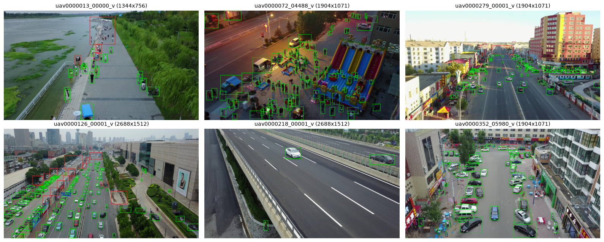

### 3.3 Size of the objects

| Model input size | Boxes under 8 px | Boxes under 16 px |
|---|---|---|
| 640 | 9.8% | 54.2% |
| 960 | 1.7% | 24.0% |
| 1280 | 0.6% | 9.8% |

Person, bicycle and motor are the smallest classes and bus is the largest. After the detector resizes the frame to 960 px, the median box side is 22.8 px and 73.5% of boxes are under 32 px. That is why we added smaller anchors, starting at 16 px.

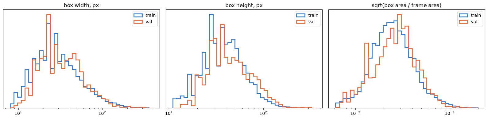

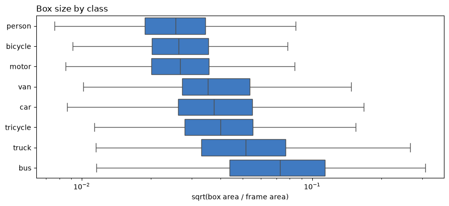

### 3.4 The disballance of different classes

- Car and person overpower the train class. There are roughly 52 cars for every bus.
- Person encompasses 44% and car 28%.
- Truck and bus are very rare especially in validation. Truck is about 1% of validation against 3% of the train. Validation therefore says very little about those two classes.

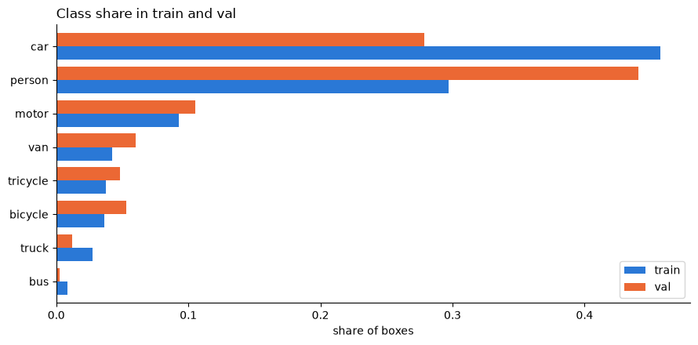

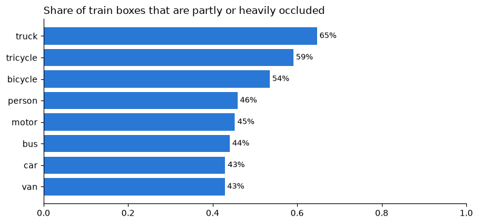

### 3.5 Objects position

- Since many objects are positioned in the center or in the lower third of the screen we kept horizontal flips only.
- The number of objects per frame: 
    - med 43
    - max 180
    
Both are below the 300-query and 500-detection limits.

Since clips vary significantly from each other we split by clips.

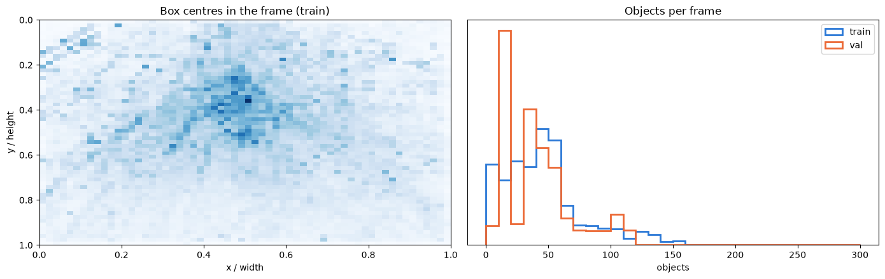

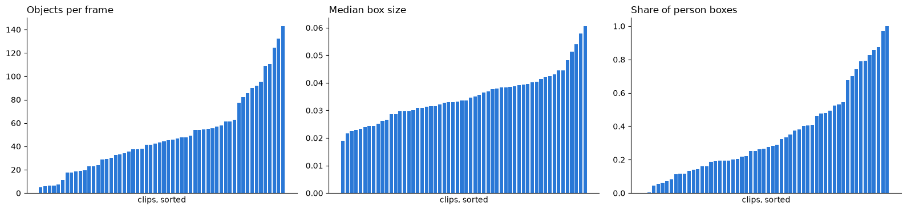

### 3.6 The difference between train and validation

The three splits barely overlap.

- 39% of test frames are 1360×764 and 26% are 1920×1080, but these sizes are only 4% and 3% of train.
- 15% of test frames are low resolution (680×382 or 960×540). These sizes never appear in train or val.
- 34% of validation frames are 4K (3840×2160). This size never appears in train or test.

So we defined `mAP_testlike` on the 4 val clips that are at most 1920 px wide (1,286 frames).

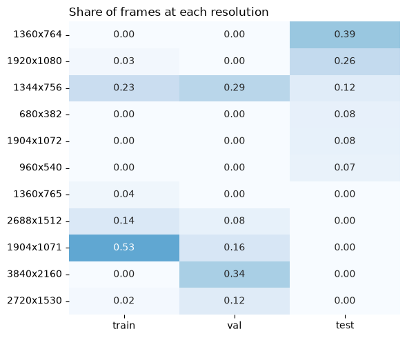

**Brightness and contrast** - On sampled frames, test is darker and has lower contrast.

| Split | Median fine detail | Median brightness | Clips with brightness < 70 |
|---|---|---|---|
| Train | 0.76 | 115.7 | 4 of 56 |
| Val | 0.74 | 100.7 | 1 of 7 |
| Test | **0.54** | 105.2 | **7 of 48** |

Test is blurrier at every resolution it shares with train, for example 0.52 vs 0.75 at 1344 px.

Validation sits right on top of train, so **val cannot reward a model for coping with blur**. That is why we added `mAP_blur` and `mAP_shift`.

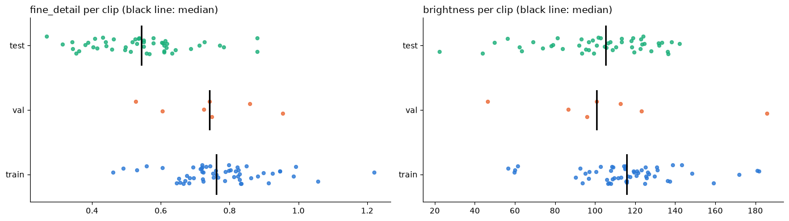

### 3.7 Neighbouring frames are nearly identical

| Gap (frames) | 1 | 2 | 5 | 10 | 30 | 60 |
|---|---|---|---|---|---|---|
| Mean pixel difference (0–255) | 6.6 | 9.4 | 15.8 | 18.8 | 26.0 | 29.5 |

The difference grows roughly linearly with the log gap and does not level off. At a gap of 5 we already have more than half of the change seen at 60, so training on every 5th frame (24,201 → 4,868 frames) keeps most of the variety.

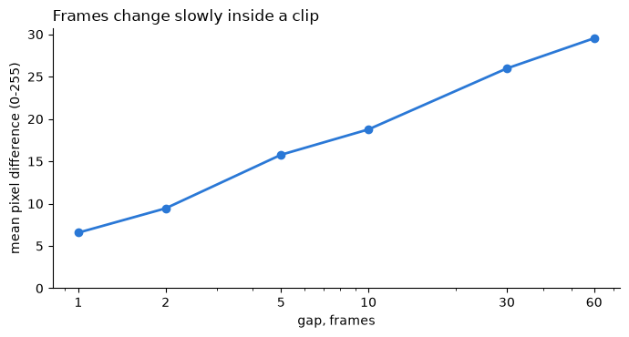

### 3.8 Ignore regions

Those regions appear on 75% of train frames but cover only 3.2% of a frame on average. However, 38,801 real boxes touch a region and 11,733 are more than half inside one.

This distribution has two peaks, with about 7,000 boxes lying fully inside a region. Painting regions grey without restoring the labelled boxes would therefore erase thousands of real objects, so we restore every labelled box after painting.

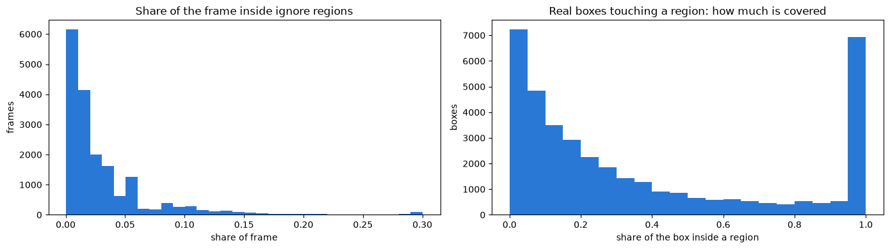

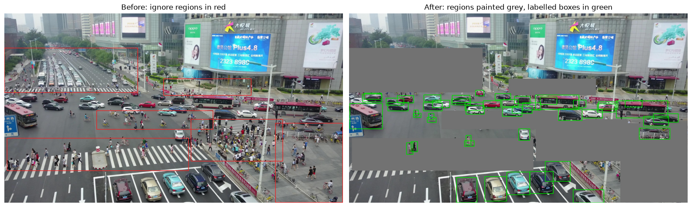

---

## 4. Protocol for comparing detectors

So that differences come from the models and not the setup, every detector in the comparison was trained the same way and scored by the same evaluator:

- 1,623 training frames (every 3rd prepared frame), for 4 epochs;
- a 960 px input for the CNN detectors; the transformer detectors use their own input sizes (RF-DETR 560 px square, Hugging Face models 960×544);
- the same COCO evaluator, with `maxDets=500` and ignore regions kept as `iscrowd`;
- the same metrics: `mAP_testlike` and per-clip mAP on top of the standard COCO numbers.

Every result is written to `experiment_log.csv`.

---

## 5. Results of the detector comparison

### 5.1 Faster R-CNN (two-stage, anchor-based)

| Run | Change | mAP | Test-like | AP50 | AP_small | ms/frame | Clips better |
|---|---|---|---|---|---|---|---|
| frcnn-base | default anchors | **0.195** | **0.223** | 0.398 | 0.078 | 28.9 | n/a |
| frcnn-anchors | anchors from 16 px | 0.192 | 0.203 | 0.411 | **0.086** | 25.6 | 4/7 |
| frcnn-giou | + GIoU box loss | 0.180 | 0.194 | 0.400 | 0.085 | 16.6 | 1/7 |
| frcnn-rpn | + more proposals/RoIs | 0.193 | 0.207 | **0.416** | 0.084 | 45.3 | 4/7 |

Small anchors helped in finding more tiny objects, but placed boxes less precisely, so mAP did not rise.

Using GIoU proved to be ineffective. More proposals gave the best AP50 at 57% more inference time.

The worst miss rate is in the **night clip** (60 of 93 objects missed), where the pedestrians objects along the dark roadside are almost all missed by the model. 

In the other two clips, misses concentrate at the edges of a frame or in small groups of pedestrians.

One frame also misses a large vehicle at the bottom edge, so failures are not solely dependent on the size. Lightning and frames, populated with multiple objects, have a significant impact.

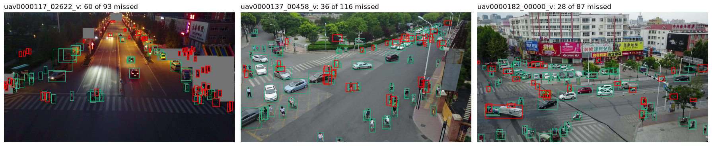

### 5.2 RetinaNet (one-stage, anchor-based)

| Run | Change | mAP | Test-like | AP_small | Clips better |
|---|---|---|---|---|---|
| retinanet-base | default | **0.149** | **0.178** | 0.049 | n/a |
| retinanet-anchors | small anchors | 0.122 | 0.142 | 0.055 | 0/7 |
| retinanet-focal | + focal γ=1.5 | 0.128 | 0.147 | **0.056** | 2/7 |
| retinanet-iou | + IoU thresholds 0.4/0.3 | 0.127 | 0.143 | 0.055 | 0/7 |

All three changes raised AP_small a little, but cut AP_large sharply, from about 0.30 to about 0.23. That is where the overall loss comes from. RetinaNet is clearly weaker than Faster R-CNN, which reaches about 0.35 AP_large, but it is faster at about 10 ms per frame.

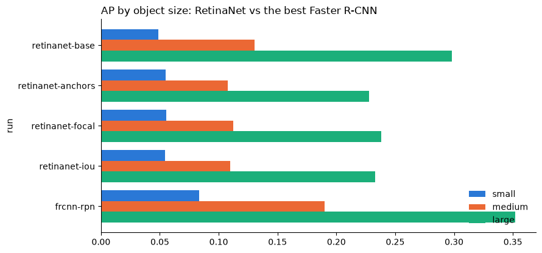

### 5.3 YOLO and FCOS (one-stage, anchor-free)

| Run | Change | mAP | Test-like | AP_small | ms/frame | Clips better |
|---|---|---|---|---|---|---|
| yolo11n-base | default, 960 | 0.140 | 0.144 | 0.055 | 3.5 | n/a |
| yolo11n-1280 | input 1280 | **0.171** | 0.173 | **0.087** | 3.5 | 5/7 |
| yolo11n-box | box loss gain 10 | 0.136 | 0.154 | 0.058 | 3.4 | 2/7 |
| yolo26n-base | YOLO26n | 0.151 | **0.189** | 0.062 | 3.7 | 3/7 |
| fcos-base | FCOS default | 0.160 | 0.176 | 0.058 | 24.9 | n/a |
| fcos-center | centre radius 2.5 | 0.151 | 0.164 | 0.051 | 24.8 | 0/7 |
| fcos-levels | level sizes 4–64 | 0.148 | 0.152 | 0.052 | 25.6 | 0/7 |

- **Input resolution had the biggest impact** At 1280 px, YOLO11n gained on every object size, not just small ones at no extra inference cost.
- On the same backbone as RetinaNet, FCOS beats it (0.160 vs 0.149), so dropping anchors helped slightly. Both FCOS changes aimed at small objects the cost us performance on every clip.

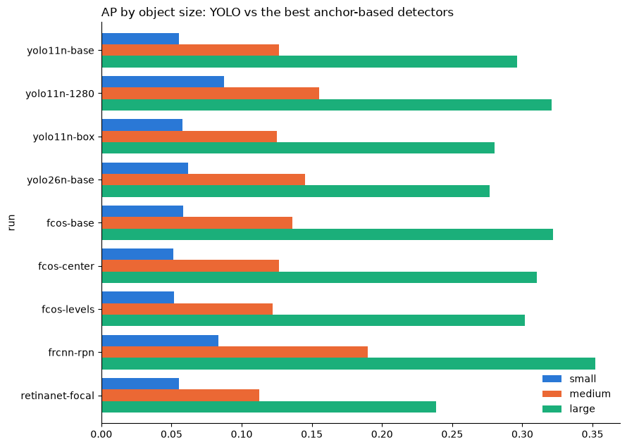

### 5.4 Query-based detectors (DETR family)

| Run | mAP | Test-like | AP_small | ms/frame |
|---|---|---|---|---|
| rtdetr-base (RT-DETR-L, lr 1e-4) | 0.007 | 0.008 | 0.001 | 20.0 |
| rtdetr-lr (lr 2e-4) | 0.039 | 0.041 | 0.014 | 20.2 |
| rtdetr-640 | 0.013 | 0.013 | 0.007 | 13.2 |
| rtdetr-640-long (16 epochs) | 0.065 | 0.066 | 0.030 | 12.9 |
| rfdetr-base (560 px) | 0.234 | 0.269 | 0.091 | 13.1 |
| rfdetr-lr (lr ×2) | 0.209 | 0.236 | 0.090 | 13.2 |
| **rfdetr-res (784 px)** | **0.257** | **0.302** | **0.120** | 27.3 |
| dfine-s-base | 0.207 | 0.235 | 0.082 | **8.7** |
| dfine-s-queries (500 queries) | 0.196 | 0.224 | 0.086 | 9.2 |
| rtdetrv2-r18-base | 0.196 | 0.212 | 0.089 | 11.5 |
| deformable-detr-base | 0.086 | 0.089 | 0.029 | 80.9 |

**RF-DETR** was the best detector we've tested. It is about 0.06 mAP above Faster R-CNN, and the 784 px input improved it on all 7 clips. D-FINE-S gave the best accuracy for its speed.

- RF-DETR, D-FINE and RT-DETRv2 had already levelled off by epoch 3–4.
- YOLO11n was still increasing performance at epoch 4.
- **RT-DETR with 16 epochs flattened at about 0.06 from epoch 9 and further.** 
- Deformable DETR was still rising slowly at epoch 4.

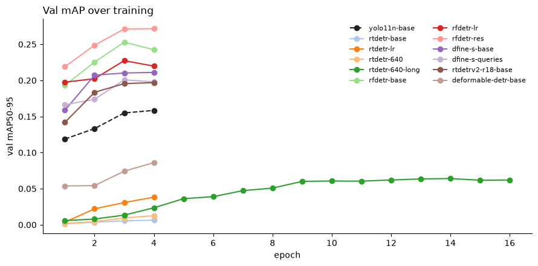

RF-DETR at 784 px is best at every object size. D-FINE-S reaches about 0.38 AP_large, close to RF-DETR, despite being a much smaller model.

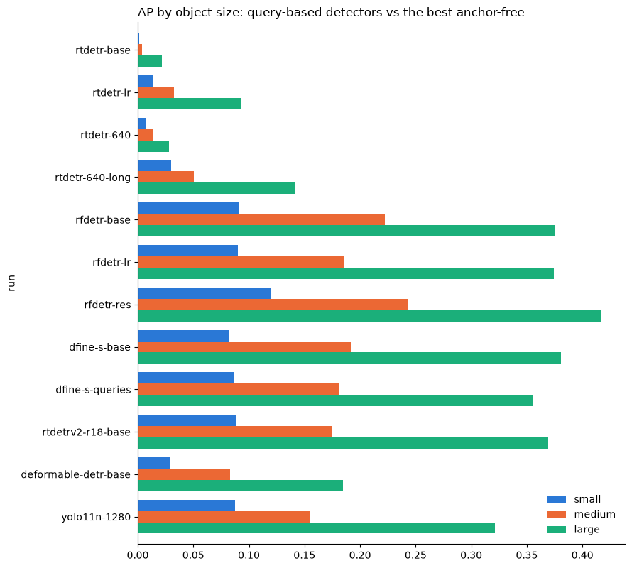

### 5.5 All detectors comparison side by side

- On speed, YOLO runs at 3–4 ms per frame, the CNN detectors and RF-DETR at 10–45 ms, and Deformable DETR at 81 ms.

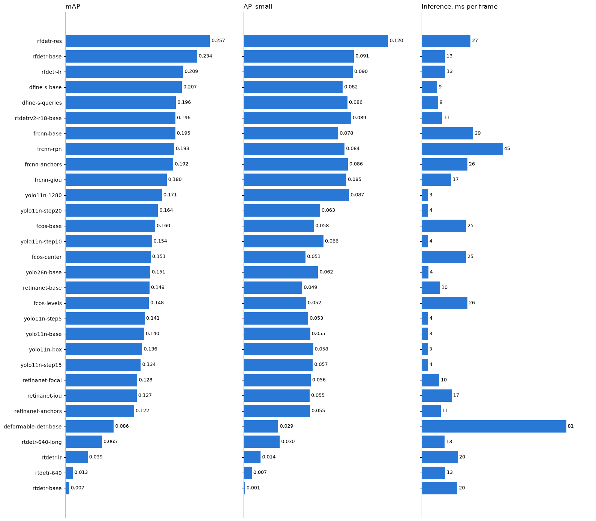

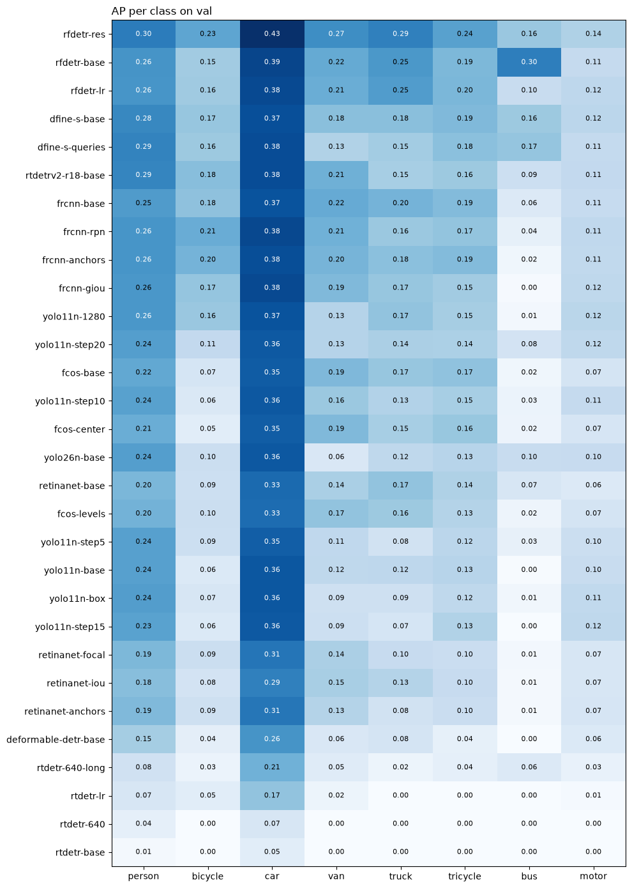

**AP per class**, from the heatmap, best run `rfdetr-res`:

| person | bicycle | car | van | truck | tricycle | bus | motor |
|---|---|---|---|---|---|---|---|
| 0.30 | 0.23 | **0.43** | 0.27 | 0.29 | 0.24 | 0.16 | **0.14** |

- Car is the easiest class for every model.
- Motor and bicycle are the hardest: because of the size mostly and also the rider.
- Bus is unstable in all of the runs, from 0.00 to 0.30 (rfdetr-base 0.30 vs rfdetr-res 0.16), because of its 264 validation boxes.

**Conclusion**

1. With only 4 epochs of training it is safe to say that **pretraining quality decides the ranking**. The DINOv2 backbone of RF-DETR dominates, while RT-DETR and Deformable DETR fail.

---

## 6. Results of our pipeline

### 6.1 Frame step at a fixed budget

| Frame step | Frames × epochs | mAP | AP_small |
|---|---|---|---|
| 5 | 4,868 × 2 | 0.141 | 0.053 |
| 10 | 2,434 × 4 | 0.154 | 0.066 |
| 15 | 1,623 × 6 | 0.134 | 0.057 |
| 20 | 1,217 × 8 | **0.164** | 0.063 |

Mostly there was no trend here whatsoever.

Within this range, more distinct frames do not help, and the differences are probably the noise.

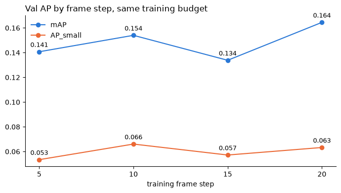

### 6.2 Model, data and augmentation experiments

| Step | Run | mAP | Test-like | Blur | **mAP_shift** | AP_small | ms/frame | Train min |
|---|---|---|---|---|---|---|---|---|
| Baseline | yolo11n-960 | 0.141 | 0.168 | 0.151 | 0.159 | 0.068 | 3.5 | 12 |
| Exp 1 | predict at 1280 | 0.145 | 0.174 | 0.156 | 0.165 | 0.100 | 3.7 | n/a |
| Exp 2 | test-time augmentation | 0.153 | 0.173 | 0.158 | 0.166 | 0.067 | 11.0 | n/a |
| Exp 3 | **train at 1280** | 0.164 | 0.203 | 0.181 | **0.192** | 0.091 | 3.5 | 21 |
| Exp 4 | YOLO11s at 960 | 0.140 | 0.153 | 0.135 | 0.144 | 0.085 | 4.1 | 20 |
| Exp 5 | YOLO11s at 960, best.pt | 0.172 | 0.218 | 0.197 | 0.208 | 0.094 | 4.1 | n/a |
| Exp 6 | YOLO11s at 1280 | 0.176 | 0.196 | 0.164 | 0.180 | 0.088 | 5.5 | 36 |
| Exp 7 | + scale 0.9, mixup, cosine LR | 0.186 | 0.212 | 0.179 | 0.195 | 0.109 | 5.6 | 36 |
| Exp 9 | YOLO26s, same recipe | 0.182 | 0.210 | 0.179 | 0.195 | 0.100 | 6.9 | 77 |
| Exp 10 | **half the frames at test quality** | 0.185 | 0.197 | **0.191** | 0.194 | 0.087 | 6.6 | 61 |
| Exp 11 | YOLO11m | 0.198 | 0.236 | 0.227 | 0.232 | 0.119 | 16.3 | 127 |
| **Exp 11b** | **YOLO11l** | **0.239** | **0.246** | **0.233** | **0.239** | 0.110 | 22.7 | 160 |
| Exp 12 | YOLO26s on test-quality mix | 0.200 | 0.208 | 0.207 | 0.208 | 0.107 | 6.9 | 77 |
| Exp 13 | train at 1536 | 0.196 | 0.202 | 0.193 | 0.198 | 0.117 | 8.4 | 89 |
| Exp 14 | every 3rd frame | 0.175 | 0.196 | 0.190 | 0.193 | 0.103 | 6.6 | 96 |

What these results show:

- **Training at 1280 px** was the biggest single step, +0.033, better on 7/7 clips.
- YOLO11s at 960 px overfits. Its val mAP peaked at epoch 3 and then fell. Stronger augmentation in Experiment 7 fixed part of this (+0.015).
- **Training at test image quality** did what we expected. `mAP_blur` rose from 0.179 to 0.191 and sharp test-like mAP fell from 0.212 to 0.197, so the net effect on validation was neutral. Its value is robustness on blurred frames, which plain val cannot show.

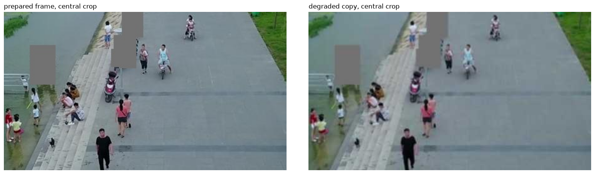

- **Model size was the next limit:** YOLO11m gained +0.038 and YOLO11l +0.045 over YOLO11s, with YOLO11l better on 7/7 clips. Training time grew to 160 minutes.

### 6.3 Inference tuning on YOLO11l

| Setting | mAP | mAP_shift | ms/frame |
|---|---|---|---|
| conf 0.01 → **0.001** | 0.243 | 0.242 | 22.9 |
| NMS IoU 0.5 / 0.6 / **0.7** | 0.241 / 0.242 / 0.243 | 0.241 / 0.242 / 0.242 | about 23 |
| input 1536 | 0.247 | 0.239 | 32.8 |
| **input 1920** | 0.241 | 0.243 | 58.8 |
| input 2240 | 0.221 | 0.230 | 87.5 |
| 2×2 tiles | 0.219 | 0.243 | 459.9 |
| **TTA** | **0.257** | **0.259** | 143.5 |

We chose conf 0.001, NMS IoU 0.7, a 1920 px input and TTA, without tiles.

- At 2240 px the smallest objects improved (AP_small 0.136), but everything else got worse.
- Tiling was 20 times slower and gave no gain.
- TTA added about +0.02 on every metric.

### 6.4 Extra models for the ensemble

| Run | mAP | Test-like | Blur | mAP_shift | AP_small |
|---|---|---|---|---|---|
| frcnn-full (all frames, 800–1333 px, 6 epochs) | 0.209 | 0.225 | n/a | 0.211 | 0.123 |
| frcnn-blur (same, test-quality mix) | 0.218 | 0.232 | 0.213 | 0.222 | 0.115 |
| frcnn-blur + horizontal-flip view, fused | 0.229 | 0.240 | 0.223 | 0.232 | 0.130 |
| rfdetr-full (784 px, all frames, 12 epochs) | 0.258 | 0.288 | **0.280** | **0.284** | 0.117 |

RF-DETR trained longer did not improve on sharp val, but it was the best model on blurred frames. Fusing Faster R-CNN with its own flipped view helped on 7/7 clips at no training cost.

### 6.5 Ensembles with Weighted Boxes Fusion

| Ensemble (YOLO11l-TTA + …) | mAP | mAP_shift |
|---|---|---|
| (YOLO11l-TTA alone) | 0.257 | 0.259 |
| + frcnn-full, weights 2:1, IoU 0.65 | 0.278 | 0.279 |
| + frcnn-blur, weights 2:1, IoU 0.65 | 0.282 | 0.282 |
| + frcnn-blur & flip, weights 2:1, IoU 0.65 | 0.285 | 0.285 |
| **+ rfdetr-full**, weights 1:1, IoU 0.55 | 0.288 | **0.303** |
| + rfdetr-full, weights 2:1, IoU 0.65 | 0.292 | 0.301 |
| + rfdetr-full + frcnn-blur & flip | 0.299 | 0.308 |
| + rfdetr-full + yolo26s | 0.292 | 0.307 |
| + every model at once (6 members) | 0.288 | 0.298 |
| best 3-family ensemble, `box_and_model_avg` scoring | 0.300 | **0.309** |
| same, `max` scoring | 0.290 | 0.296 |

- RF-DETR was the best match with YOLO. Its errors differ the most from YOLO's.
- A third family (Faster R-CNN) added a little more.
- Adding several similar models (more Faster R-CNNs, a second YOLO) made the result *worse*.
- `max` scoring hurt because it keeps boxes that only one model found ranked too high.

### 6.6 Temporal rescoring

Each box's score is mixed with the scores of matching boxes in neighbouring frames: `(1 − w)·score + w·mean(neighbour scores)`.

| k (frames each side) | w | mAP | mAP_shift | Clips better |
|---|---|---|---|---|
| 1 | 0.3 | 0.303 | 0.311 | 5/7 |
| 1 | 0.6 | 0.299 | 0.308 | 1/7 |
| **2** | **0.3** | **0.303** | **0.312** | 5/7 |
| 2 | 0.6 | 0.300 | 0.309 | n/a |

A light weight added about +0.003. A heavy weight hurt, because it penalises objects that are briefly hidden or have just appeared.

### 6.7 Where the improvement came from

(69 runs ranked by val mAP and `mAP_shift`), the gain looks like this:

| Step | mAP_shift | Gain |
|---|---|---|
| Baseline YOLO11n at 960 px | 0.159 | n/a |
| Train at 1280 px | 0.192 | +0.033 |
| YOLO11s → YOLO11l with stronger augmentation and the test-quality mix | 0.239 | +0.047 |
| Inference tuning (conf, 1920 px, TTA) | 0.259 | +0.020 |
| WBF with RF-DETR | 0.303 | +0.044 |
| + Faster R-CNN (two views), fusion settings | 0.309 | +0.006 |
| + temporal rescoring | **0.312** | +0.003 |

The final model beats the baseline on all 7 val clips, with a mean per-clip gain of +0.145 mAP. 

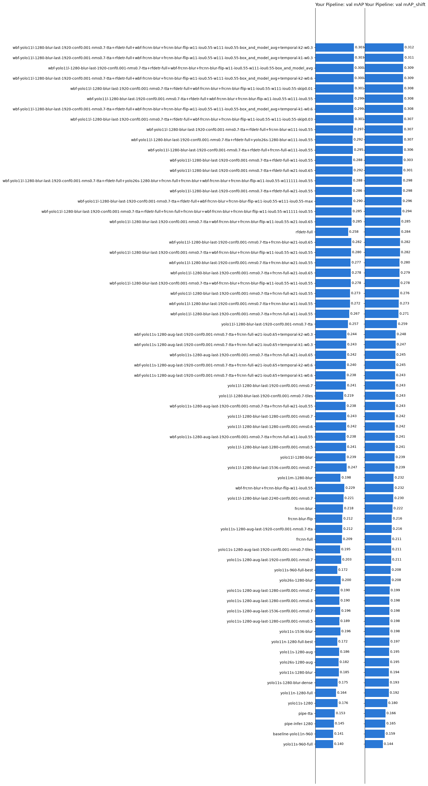

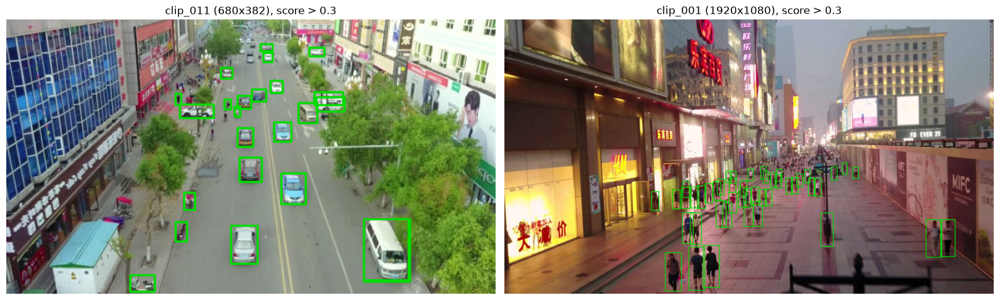

---

## 7. Leaderboard

| Submission | Val mAP_shift | Public | Private |
|---|---|---|---|
| Baseline: YOLO11n, 960 px | 0.159 | 0.2322 | 0.1540 |
| WBF of YOLO11s-TTA + Faster R-CNN, temporal rescoring | n/a | 0.2577 | 0.2278 |
| Same, YOLO11s retrained on train + val | n/a | 0.2449 | 0.2352 |
| **Final submission** | **0.312** | **0.3205** | **0.2749** |

---

## 8. Conclusions

1. Data analysis paid off more than tuning detectors. The image-quality analysis showed that validation misrepresents test, and our selection metric `mAP_shift` came directly from that finding.
2. Resolution and capacity mattered most. Training at 1280 px and going from YOLO11n to YOLO11l together raised `mAP_shift` by about 0.08. Hand-tuned label assignment for small objects did not help in any family.
3. Different model families work well together in an ensemble. Fusing YOLO with RF-DETR, which has a different architecture and pretraining, gave +0.044. Adding similar models hurt.

**Limitations**

- We used one val split of 7 clips; differences under about 0.01 are likely noise.
- Ensemble weights, inference settings and temporal parameters were chosen on the same clips that score them, so the final val numbers are optimistic.
- The 4-epoch protocol penalises transformers that need long training.
- The final ensemble runs at about 266 ms per frame, which suits a competition but not real-time use.

---

## 9. Final model and how to run

| Member | Training | Inference |
|---|---|---|
| YOLO11l | 1280 px, scale 0.9, mixup 0.1, cosine LR, half the frames at test quality, 20 epochs | 1920 px, conf 0.001, NMS IoU 0.7, TTA |
| RF-DETR-B | 784 px, all prepared frames, 12 epochs | 784 px |
| Faster R-CNN | small anchors, 800–1333 px, test-quality mix, 6 epochs | original + horizontal flip, WBF 1:1, IoU 0.55 |
| Fusion | | WBF 1:1:1, IoU 0.55, `box_and_model_avg`, then temporal rescoring k = 2, w = 0.3 |

```bash
pip install torch torchvision --index-url https://download.pytorch.org/whl/cu128
pip install -r requirements.txt
echo "KAGGLE_API_TOKEN=<your token>" > .env
jupyter lab hw-2.ipynb   # set the flags below, then Run All
```

| Flag (first code cell) | Value | Effect |
|---|---|---|
| `SMOKE_TEST` | `True`, then `False` | short check of every step, then the full run |
| `TRAIN` / `FORCE` | `True` / `False` | train missing runs, reuse finished ones from `outputs/runs` |
| `SELECT_METRIC` | `'mAP_shift'` | metric for every selection step |
| `TRY_P2_HEAD` | `False` | skip the optional P2-head run |
| `USE_TRAINVAL` | `False` | no retraining on train + val |
| `SUBMIT` | `True` | write the submission CSV and send it to Kaggle |

Seed: `SEED = 42` for training, frame sampling and image degradation. Hardware: RTX 5090 Laptop GPU.
